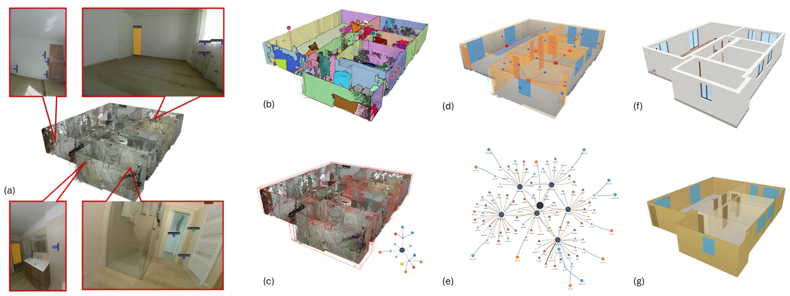
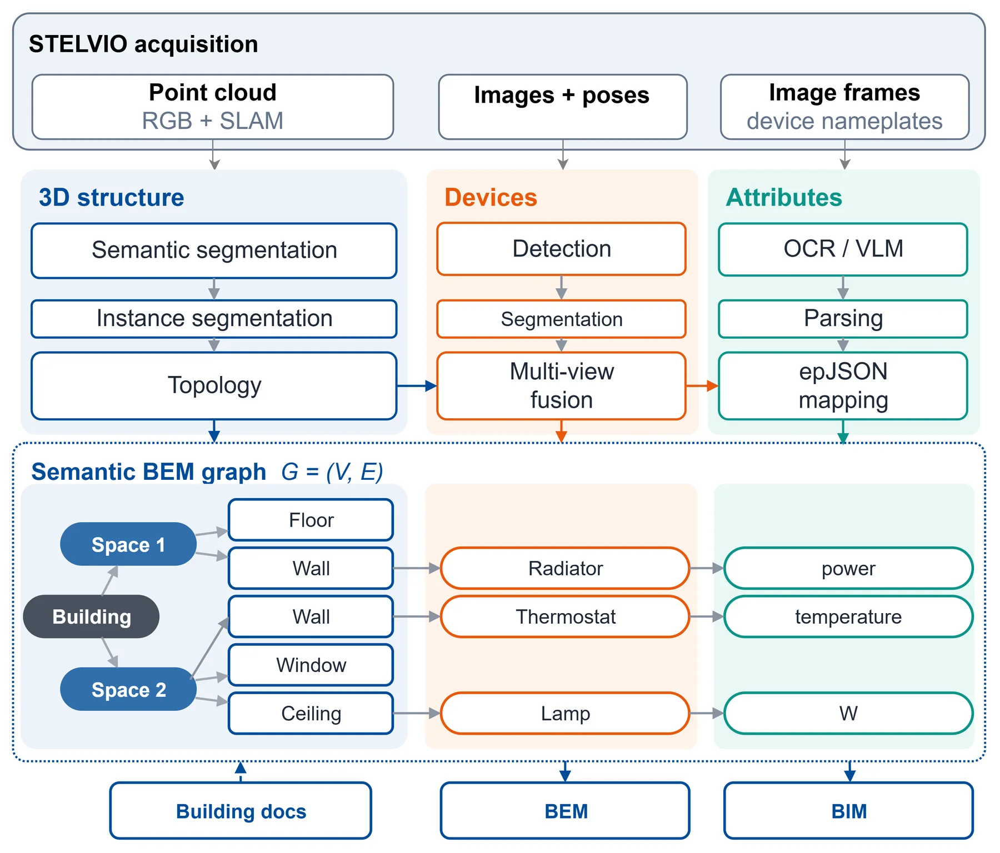
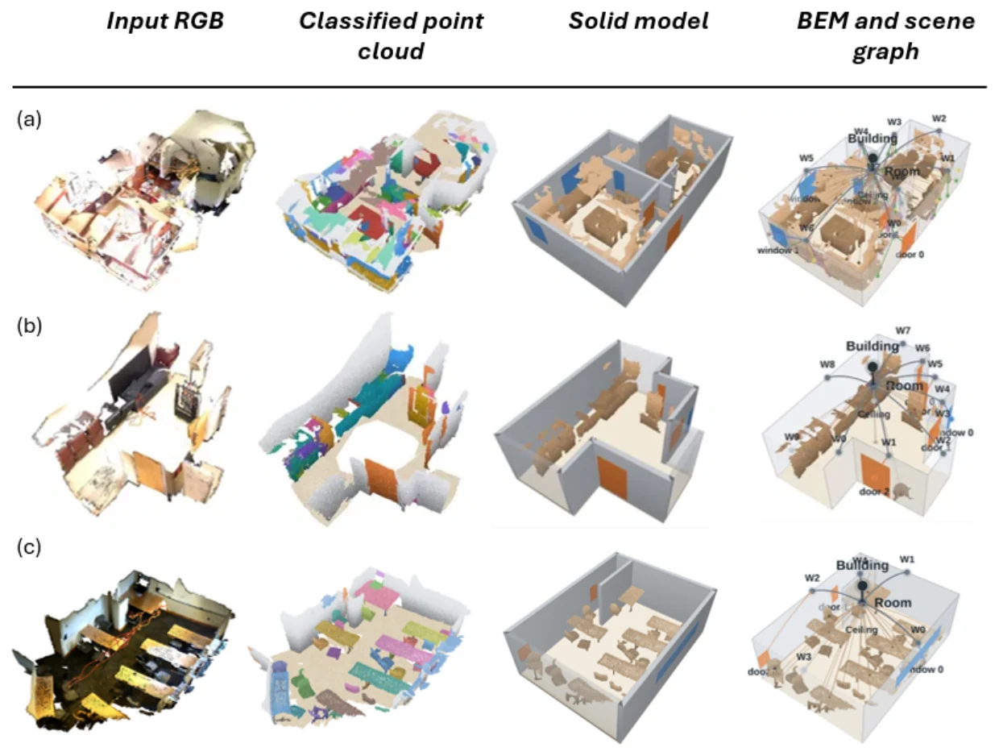
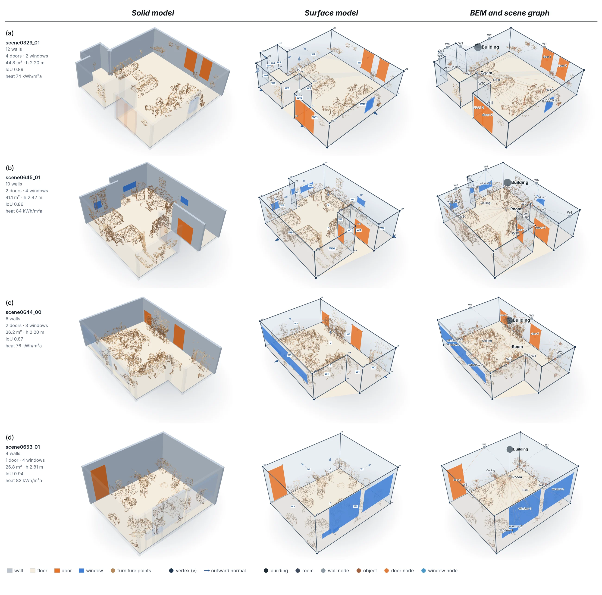

# Towards Building Energy Digital Twins with a Low-Cost Portable Mobile Mapping System

**Oscar Roman, Paweł Trybała, Elisa Mariarosaria Farella, Fabio Remondino**
3D Optical Metrology (3DOM) unit, Bruno Kessler Foundation (FBK), Trento, Italy

ISPRS LC3D 2026 · Power Twin project

**[Project page](https://oscar88roman.github.io/power_twin_lowcost/)** | **[Results for all 312 ScanNet scans](https://oscar88roman.github.io/power_twin_lowcost/#explorer)** | **[Videos](https://oscar88roman.github.io/power_twin_lowcost/#media)** | **[Power Twin](https://powertwin.fbk.eu/)** | **[3DOM](https://3dom.fbk.eu)**



*From a low-cost survey to an energy model: point cloud and detections (a), 3D devices and panoptic segmentation (b), solid model (c), surface-based model (d), semantic graph (e), BIM (f) and BEM (g).*

## About the project

Power Twin is about making Building Energy Digital Twins of existing buildings without modelling everything by hand. In this paper we walk through a building with STELVIO, our low-cost portable mapping system, and turn what it records into a model that EnergyPlus can simulate.

The workflow reconstructs walls, floors, ceilings and openings from the point cloud. It finds energy-related devices (radiators, lights, sockets, sensors, HVAC units) in the images and places each one in 3D, and it reads technical parameters from the device nameplates with OCR. Everything is linked to rooms, surfaces and thermal zones in a typed semantic graph, which we export to EnergyPlus epJSON and to a BIM environment.



## Main results

| | |
|---|---|
| ScanNet scans that give a valid EnergyPlus model | 311 of 312 |
| IoU for floor, ceiling and wall | 87 to 94% |
| Instance-level F1 for energy devices (best setup, YOLO-World + SAM2) | 54.0% |
| Nameplate parameters read correctly by OCR | 92% (48 of 52) |
| Median footprint IoU / wall-point distance | 0.81 / 3.2 cm |
| Recognition and fusion per scene on a laptop GPU (RTX 4050) | about 6 minutes |

We also ran the full workflow on a real six-room flat (about 80 m², 447 images, about 19 million points). The resulting graph has 70 nodes and 78 edges.



## Interactive results

The [project page](https://oscar88roman.github.io/power_twin_lowcost/) follows the paper section by section. At the end there is an explorer for all 312 ScanNet scans. For each scan you can look at the input point cloud, the panoptic segmentation, the solid model, the EnergyPlus surface model and the semantic graph, together with footprint, area, height, wall-fit and energy metrics. To open a specific scan directly, add its ID to the address, for example [`#scene0025_00`](https://oscar88roman.github.io/power_twin_lowcost/#scene0025_00).

The page also has three short videos: the scene graph being built for a ScanNet scan, a walkthrough of two ScanNet scans (panoptic point cloud, solid model and BEM with graph), and a BIM/BEM walkthrough of the case-study flat.



## What is in this repository

| Path | Content |
|---|---|
| `index.html` | the project page |
| `assets/` | paper figures |
| `media/` | videos, extra figures and an interactive 3D view of the case-study flat |
| `data/scenes.json` | reconstructed model and metrics for every scan |
| `data/pts/` | a 45,000-point sample of each scan |
| `data/thumbs/` | gallery thumbnails |

The site is static and is published with GitHub Pages. To view it on your own computer, run `python -m http.server 8000` in this folder and open http://localhost:8000 (opening `index.html` directly will not load the scan data).

## Citation

```bibtex
@inproceedings{roman2026lowcost,
  title     = {Towards Building Energy Digital Twins with a Low-Cost Portable Mobile Mapping System},
  author    = {Roman, O. and Trybała, P. and Farella, E. M. and Remondino, F.},
  booktitle = {ISPRS LC3D 2026},
  year      = {2026}
}
```

Related papers from our group:

- Roman, O., Bassier, M., Agugiaro, G., Arroyo Ohori, K., Farella, E.M., Remondino, F., 2025. [Scan-to-EDTs: Automated generation of Energy Digital Twins from 3D point clouds](https://www.mdpi.com/2075-5309/15/22/4060). *Buildings*, 15(22), 4060.
- Roman, O., Bassier, M., De Geyter, S., De Winter, H., Farella, E.M., Remondino, F., 2024. BIM module for deep learning-driven parametric IFC reconstruction. *ISPRS Archives*, XLVIII-2/W8-2024, 403–410.
- Trybała, P., Morelli, L., Facenda, S., Razzino, A., Remondino, F., 2025. STELVIO: Exploring factor graphs for a robust stereo-visual-LiDAR-inertial odometry. *ISPRS Archives*, XLVIII-1/W5-2025, 125–131.

## Acknowledgement

This study was carried out within the Power Twin project, supported by the 2026 PoC by Trentino – Test Your Idea! programme, promoted by Fondazione Bruno Kessler and the University of Trento (Italy).
